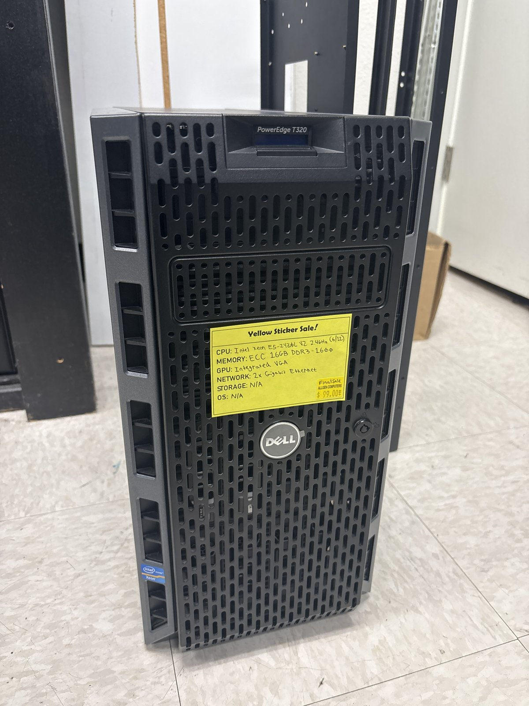
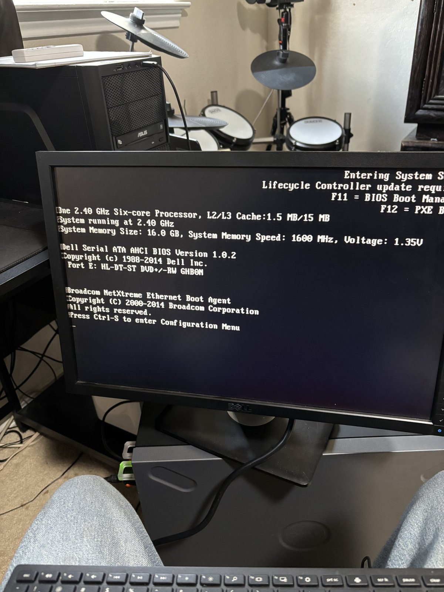
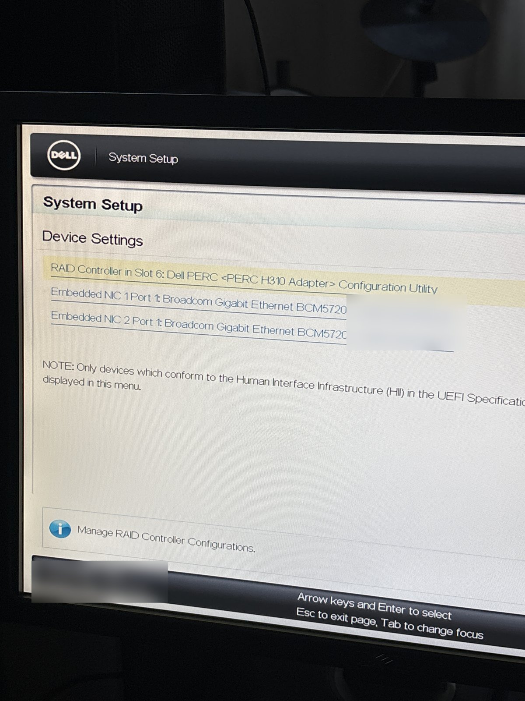
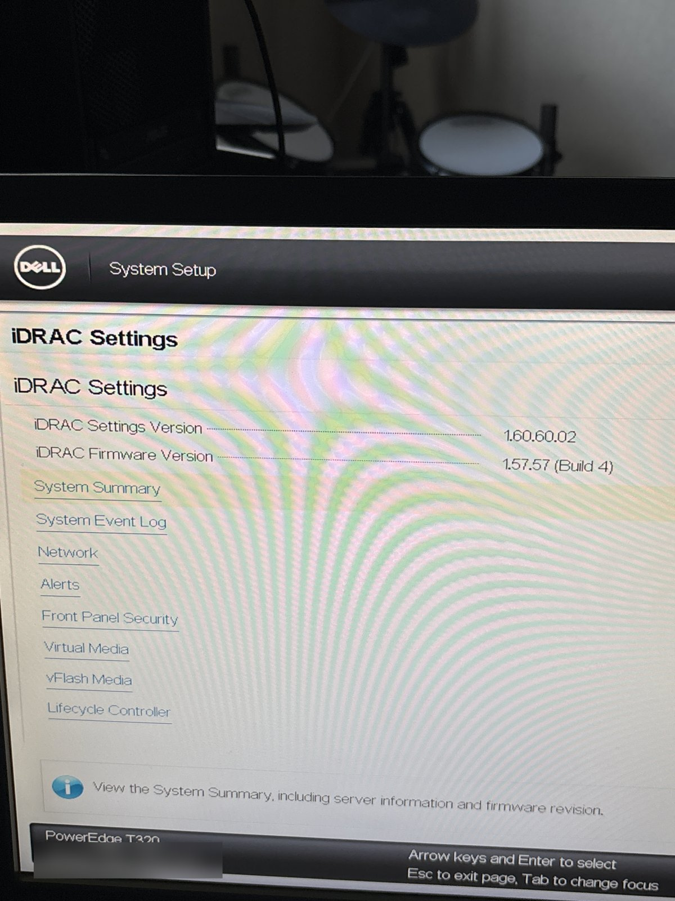
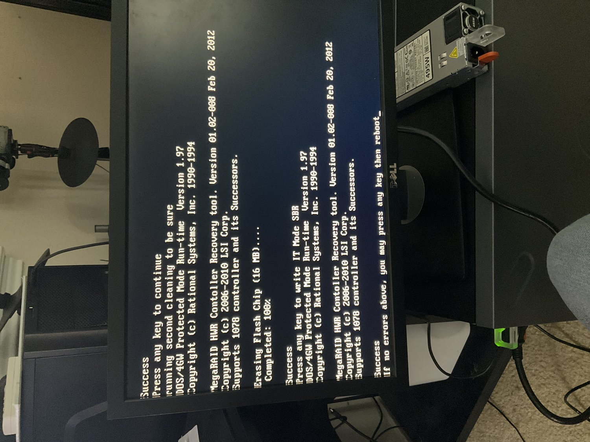

# T320 NAS build

Build log for replacing the old homelab box with a Dell PowerEdge T320
running TrueNAS SCALE. Written as I go, so later steps fill in over time.

## Why

The old NAS (a desktop running Debian with two data drives) hangs during
POST on every reboot and needs someone to press the reset button by hand.
It also only has room for two data drives. The plan is to split its jobs:

- T320: storage only (TrueNAS SCALE, ZFS, NFS shares for the Docker VM)
- OptiPlex 3040: Jellyfin with Intel Quick Sync, plus the reverse proxy
- Old homelab box: retired once everything is moved

## The hardware

Bought used from a local computer store for $99 (final sale, no drives).



- Dell PowerEdge T320 tower
- Intel Xeon E5-2430L v2, 6 cores / 12 threads, 60W
- 16GB DDR3-1600 ECC
- 2x Broadcom BCM5720 gigabit NICs
- PERC H310 Adapter (PCIe, slot 6)
- Hot-swap 3.5" backplane, came with only 2 drive caddies
- iDRAC7 for remote power control and console

I picked a tower over another rack server because it lives in my bedroom,
and the low-power "L" CPU keeps idle draw low for a box that runs 24/7.

## Step 1: First power-on

No drives yet. The goal was to confirm the hardware and find out which
storage controller it has, since that decides whether ZFS can see the disks
directly.



POST showed the CPU and all 16GB of memory. The onboard SATA is in AHCI mode
with the DVD drive on port E, which is the spare port the boot SSD will use.
It also said "Lifecycle Controller update required". That only affects
Dell's built-in update/OS tool, so I left it for later.

Device Settings in System Setup (F2) showed the storage controller:



A PERC H310 is a RAID card. ZFS wants raw access to every disk (no RAID
layer in between) so it can handle redundancy and read SMART data itself.
The H310 can be crossflashed to LSI 9211-8i firmware in IT mode, which
turns it into a plain HBA. That is the next step, done before any drives
go in.

iDRAC is set to a static address on the LAN so the server can be power
cycled remotely. The firmware on it is very old:



That version only speaks TLS 1.0, so no modern browser will open its web
UI. I planned to update it, but then found out it wouldn't help: logging in
over SSH printed `License Violation: "SSH"`. This one only has the iDRAC7
Basic license, so there's no web UI or SSH at any firmware version, just
IPMI. IPMI over LAN didn't work at first because the
"Enable IPMI Over LAN" change never got saved. You have to leave System
Setup through Finish and say Yes to saving. After that, `ipmitool` could
power cycle it and read temps and fans.

## Step 2: Flash the H310 to IT mode

I followed Fohdeesha's PERC crossflashing guide (H310 Full Size section).
The guide ships two live images, FreeDOS and Debian. I put both on one USB
stick with Ventoy.

Prep, per the guide:
- Disabled Virtualization Technology, SR-IOV and I/OAT DMA in the BIOS
- Kept boot mode on BIOS, not UEFI
- No drives connected to the card

In FreeDOS, `info` confirmed a PERC H310 Adapter, chip revision B2. I wrote
down the card's SAS address there, because the flash wipes it. Then
`310FLCRS` erased the Dell firmware (twice, to be sure) and wrote the IT
mode SBR:



Next I booted the Debian image. It has SSH, so I ran the rest from another
machine. The `H310` script boots the card from RAM, then flashes LSI's
9211-8i IT firmware (20.00.07.00) to the card's flash and verifies it.
After one reboot, `setsas` put the original SAS address back, and `info`
then showed:

```
Firmware Product ID : 0x2213 (IT)
Firmware Version    : 20.00.07.00
Board Name          : SAS9211-8i
BIOS Version        : N/A
```

I skipped the boot ROM. Nothing boots from this card, since the boot SSD
goes on the onboard SATA port, and without the ROM the card adds no time
to POST.

Annoyances:
- The F11 boot menu froze the first time after a cold boot. Setting a
  one-time boot with `ipmitool chassis bootdev disk` and resetting was
  more reliable.
- After a warm reboot the BIOS often didn't see the USB stick at all.
  A full power off and on through IPMI fixed it every time.

## Step 3: Boot SSD and TrueNAS install

The boot drive is a spare Samsung PM851 256GB SSD. It goes on onboard SATA
port E using the DVD drive's data cable and a normal SATA power plug. That
port only links at SATA2 (3Gbps), which doesn't matter for a boot drive.

I added the TrueNAS SCALE 25.10 ISO to the same Ventoy stick from step 2
and checked its SHA256 on the stick.

The SSD still had an old Linux install on it, so the BIOS booted that
instead and landed at a `grub rescue>` prompt. The normal fix is to pick
the USB stick from the F11 boot menu, but the graphical F2/F11 menus kept
freezing (with two different keyboards, so it wasn't the keyboard). The
workaround:

1. Unplugged the SSD's data cable
2. Booted the live Debian image from the stick with
   `ipmitool chassis bootdev disk` and a reset
3. Plugged the SSD back in while it was running (SATA is hot-pluggable)
4. Over SSH, ran `wipefs -a` on it and zeroed the first and last 16MB to
   clear the old partition tables

With nothing bootable on the SSD, a cold boot went straight to the stick
and the TrueNAS installer. I installed to the SSD in legacy BIOS mode and
answered No to "Allow EFI boot", since this box boots BIOS only. The
installer's shutdown hung on "watchdog did not stop", so I reset it through
IPMI. After that it booted TrueNAS on its own.

After first boot:

- Gave it a static IP below the router's DHCP range. I did this through
  the TrueNAS API, which applies network changes with a 60 second rollback
  timer. If you don't check in before the timer runs out (in case the new
  address locked you out), it puts the old settings back.
- Made an API key for scripting. TrueNAS revokes an API key if it is ever
  sent over plain HTTP, so it only gets used over HTTPS.
- Set the time zone.

The only monitor I had free to leave on it is a 1992 Packard Bell CRT. It
only does 640x480 at 60Hz (and 720x400 for text mode) and has no EDID, so
Linux picked a higher mode and the screen showed static. Adding the kernel
option `video=640x480@60` in TrueNAS's advanced settings fixed it, and the
console menu now shows up clearly on the CRT.

## Step 4: Drives and pool

The original plan was to buy no new drives and reuse the two from the old
box:

| Drive | Type | Old role | Used |
|---|---|---|---|
| WD 4TB (WD40EZAX) | CMR | `/srv/data` | 1.3TB |
| Seagate 2TB (ST2000DM008) | SMR | `/srv/backup` | 320GB |

Both passed SMART with 0 reallocated or pending sectors. The 2TB had a
count of UDMA CRC errors, which usually comes from a bad cable, not the
disk.

The problem is that both drives are ext4, and a disk can't join a ZFS pool
without being wiped. The 4TB holds everything, and nothing else in the lab
has 1.3TB free to hold it in the meantime. So the order had to be:

1. Move the 2TB over first and make it a pool
2. Copy the 4TB's data onto it over the network (step 5)
3. Only then wipe the 4TB

The 2TB became a single-disk pool called `backup`. That's its long-term
job (an SMR drive is fine for backups and bad for anything else), so naming
it that now means no rename later. For now it also holds the copy of the
main data.

Then the plan changed: instead of several used 2TB drives, I found a used
WD 8TB (WD80EZAZ, a "white label" drive pulled from an external, CMR and
helium filled) on Facebook Marketplace for $150. Before buying I asked the
seller for SMART data on the exact drive I'd get:

- About 40,900 power-on hours (around 4.7 years), only 59 power cycles
- 0 reallocated, 0 pending, 0 uncorrectable sectors
- Helium level at 100
- The seller had already done a full zero pass, and SMART stayed clean

That's old but healthy. The plan for it:

- 8TB becomes the new main pool
- Once the data is off the old 4TB, attach the 4TB to it as a mirror
  (usable space is the smaller disk, about 3.6TB, until...)
- Later, replace the 4TB with a second 8TB, and the mirror grows to 8TB

The T320 only came with 2 caddies, so I bought a third party 4-pack that
lists the T320 as supported. It fits fine. Some shucked drives won't spin
up in servers because of the 3.3V power disable pin, but this backplane
detected the 8TB right away.

TrueNAS 25.10 removed the button and API for running SMART tests. To run a
long test anyway, I made a disabled cron job in TrueNAS that runs
`smartctl` and trigger it by hand. The long test on 8TB takes 16-18 hours.
The main pool gets built once it passes.

## Step 5: Moving the data over

Before pulling the 2TB out of the old box, I paused everything that wrote
to it: the backup timers on both hosts, the NFS export, and the fstab
lines (commented out, not deleted). The backup history on it got copied to
the 4TB and checked with `diff -rq` first, since the drive was about to be
wiped.

Pulling it broke something. When the old box came back up, every web
service was down. The startup script for the containers waits for all the
data mounts first, and it was still waiting for the 2TB. The containers
showed as "Up" but had no ports. I changed the script to only wait for
mounts that are actually listed (not commented out) in `/etc/fstab`, and
everything came back.

For the copy, I made a dataset `backup/staging`, shared it over NFS to the
old box only, and ran `rsync -aH --numeric-ids` from the old box inside
tmux, so it would survive me disconnecting.

It started at about 1MB/s. Most of the files at the start were small, NFS
writes are synchronous by default (each file waits until it's safely on
disk), and the 2TB is an SMR drive, which is slow at exactly that kind of
write. Setting `sync=disabled` on the dataset brought it to about 20MB/s on
small files and about 195MB/s on big ones. The risk is losing the last few
seconds of writes if the power cuts out, which is fine for a copy I can
just run again, and the server is on a UPS anyway.

All 1.3TB copied without errors in about 6 to 7 hours. A second rsync pass
afterwards found nothing left to transfer.

### While waiting on the main pool

The old box's backup drive is gone now, so the nightly backups had nowhere
to go. Until the main pool is built, they point at the T320 instead:

- A new dataset `backup/nightly`, shared over NFS to both hosts, takes the
  nightly app backups from both
- A nightly rsync keeps `backup/staging` in sync with the old box's data
  drive. The script refuses to run if the source drive isn't mounted or
  looks almost empty, so a failed mount can't make it delete the copy.
- ZFS snapshots of `backup/staging` every day, kept for 7 days

These mounts use NFSv3, because `rsync -A` (copy ACLs) failed over NFSv4.
They also use `x-systemd.automount`, so if the T320 is down the other
machines still boot normally and only the backup job fails.

While testing this I found that the Docker VM's backup had stopped sending
its heartbeat to Uptime Kuma two days earlier. The heartbeat token lived in
a file I had deleted while replacing ntfy with Pushover. The backup itself
was still running fine. I moved the token to the file the other scripts
use.

## Step 6: Switching services over and retiring the old box

TODO

## What I learned

TODO
